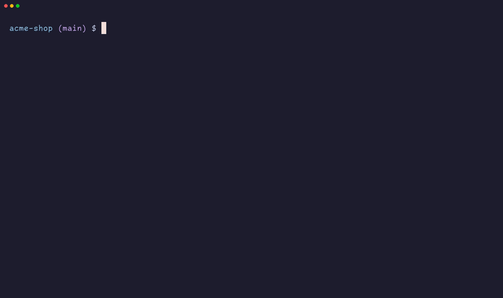

# ship-cli

Created in [T3 Code](https://t3.codes).

An interactive CLI for moving Work through Dev, Staging and Production. Run `bun ship` and the menu adapts to the branch you're on. `main` is meant to match Production (a rare manual deploy can make them drift). It's built for a small team, so it doesn't guard against two people shipping at the same moment.

The words used here are defined in [GLOSSARY.md](GLOSSARY.md), and the decisions behind the design are in [docs/adr](docs/adr).



The recording takes one Feature from `main` through Dev, Staging and Production in a sandbox repo, with a stand-in deploy command ([MP4 version](docs/demo/ship-demo.mp4)).

## Quick install

```sh
bun add -g github:mckamyk/ship#main
ship-cli
```

Run `ship-cli` from inside the repo you're shipping, which needs its own `ship.config.json`. See [Installing globally from GitHub](#installing-globally-from-github) for upgrading and pinning, or [Setup](#setup) to add it to a monorepo instead.

## Setup

This is designed to live in a Bun monorepo at `packages/ship`. When copying it in, leave out `.git`, `node_modules` and `bun.lock`, because the workspace's root lockfile takes over.

Add a script to the root `package.json`, with `packages/*` in its workspaces:

```json
{
  "workspaces": ["packages/*"],
  "scripts": { "ship": "bun packages/ship/src/cli.ts" }
}
```

Then add `ship.config.json` to the root of the repo:

```json
{
  "$schema": "./packages/ship/ship.config.schema.json",
  "deploy": {
    "dev": "bun install --frozen-lockfile && bunx sst deploy --stage dev",
    "staging": "bun install --frozen-lockfile && bunx sst deploy --stage staging",
    "prod": "bun install --frozen-lockfile && bunx sst deploy --stage prod"
  }
}
```

**Keep the `bun install` in each command.** The deploy runs in your working folder after ship has switched branches, so `node_modules` would otherwise be missing dependencies added by other features on staging.

**If an Environment has no command, the deploy only prints a warning and counts as a success**, so tags still get written and branches still get deleted. That's deliberate, so something else such as GitHub Actions can do the deploying ([ADR-0004](docs/adr/0004-missing-deploy-command-counts-as-success.md)), but ship's ordering guarantees then no longer hold. The schema flags a missing command in your editor, but the CLI doesn't check the file against it.

## Two networks

Dev is in the Nonprod Network, with the shared dev VM where code is written. Staging and Production are in the Prod Network, with the shared deploy VM that ships to them. Neither network can reach the other, but both reach origin.

Ship doesn't know which network it's in. It offers everything, and a deploy to an Environment the machine can't reach simply fails. In practice:

- **On the dev VM**, you're on a Work branch: ship to Dev, then **Push to origin**.
- **On the deploy VM**, you stay on `main` and pick Work from origin: ship a Feature to Staging or Production, or finish a Hotfix or Infrastructure Change. No branch switching needed.

If you are on a Work branch whose local copy is behind origin, ship fast-forwards it first, and stops if the two have diverged.

## Installing globally from GitHub

Instead of copying it into `packages/ship`, you can install it straight from GitHub into Bun's global bin. It isn't published to npm.

```sh
bun add -g github:mckamyk/ship#main
ship-cli
```

Bun's global bin is `~/.bun/bin`, and it must be on your `PATH`. Run `ship-cli` from anywhere inside the repo you're shipping. That repo still needs its own `ship.config.json`, and you can point `$schema` at `https://raw.githubusercontent.com/mckamyk/ship/main/ship.config.schema.json`.

To upgrade to the latest `main`, run `bun update -g ship-cli`. **Keep the `#main` in the install command.** Without a ref, Bun pins the commit it first installed, and neither `bun update -g`, `bun add -g --force` nor removing and reinstalling will move it. To pin a version instead, put a commit SHA or a pushed tag after the `#`, such as `github:mckamyk/ship#444e6c1`. To uninstall, run `bun remove -g ship-cli`.

A global install runs the version you installed, not the code on your current branch, so the note below about the CLI's own code doesn't apply to it.

## Running it in a monorepo

| Where you are | Command |
|---|---|
| Repo root | `bun ship` |
| `packages/ship` | `bun ship` |
| Any other package | `bunx ship-cli`, if the root has `"devDependencies": { "ship-cli": "workspace:*" }` |

Wherever you start it, the CLI works from the repo root. That means:

- **Config and deploys:** `ship.config.json` is read from the root and deploy commands run there. If a deploy needs another folder, put `cd` in the command.
- **Commits:** committing your work includes changes across the whole monorepo, not just the package you're in. The file list is shown first so you can check.
- **Dependencies after a ship:** `node_modules` is shared between branches, and `bun install` doesn't always remove packages from an earlier one. A deploy can therefore see packages its commit doesn't declare, so delete `node_modules` and reinstall if something only works locally.
- **The CLI's own code:** it runs from your checkout, so it's the version on your current branch, and a branch that breaks `packages/ship` breaks `bun ship` on that branch. Switching branches during a ship is safe.

## Features

Normal Work, on `ship/<name>` branches, usually going through Staging on the way to Production.

| Step | Run it from | What happens |
|---|---|---|
| Start | Any non-Work branch | Creates `ship/<name>` from the latest `origin/main` |
| Ship to dev | `ship/<name>` | Deploys the branch as it is, with no merging or tags |
| Ship to staging | `ship/<name>`, or pick from origin | Builds latest main + this Feature + every Staged Feature and deploys it. Only then force-pushes that to `staging` and tags this Feature `staging/<name>` |
| Ship to production | `ship/<name>`, or pick from origin | Squash-merges onto `main` and deploys. If that succeeds, pushes `main`, updates the prod tags, and removes the staging tag and branch |
| Remove from staging | Any branch | Rebuilds Staging without the Feature and deploys, then removes its tag. Its branch is kept, so it can be shipped again |

If the Feature's latest commit isn't the one Staging ran, shipping to Production asks which to ship, with the latest first. If you pick what Staging ran, the branch is kept so its newer commits aren't lost.

Each Feature goes to Production on its own, so Production can get a combination Staging never ran ([ADR-0001](docs/adr/0001-features-ship-independently-of-staging-combination.md)).

## Hotfixes

Hotfixes live on `hotfix/<name>` branches and skip Staging.

| Step | Run it from | What happens |
|---|---|---|
| Start | Any non-Work branch | Creates `hotfix/<name>` from the latest `origin/main` |
| Ship to dev | `hotfix/<name>` | Optional. Deploys the branch as it is |
| Finish | `hotfix/<name>`, or pick from origin | Squash-merges onto `main`, deploys to Production, updates the prod tags and deletes the branch |

Finishing then offers to rebuild Staging, because Staging doesn't have the Hotfix until it's rebuilt from the new `main`. Staged Features stay on it. If the rebuild conflicts or fails, the Hotfix still counts as shipped and you get a warning.

## Infrastructure Changes

Infrastructure Changes live on `infra/<name>` branches. Like Hotfixes they go straight to `main` and Production, but behind a Feature Flag (e.g. Pulumi config). The flag is switched on in Dev and Staging first so the change can bake, and in Production last ([ADR-0003](docs/adr/0003-infrastructure-changes-bake-behind-flags-on-main.md)). Ship doesn't manage the flags.

Start, Ship to dev and Finish work the same as for a Hotfix, including the offer to rebuild Staging.

Because a deploy applies the infrastructure in the commit being deployed, ship keeps track of which Environment has each Infrastructure Change ([ADR-0005](docs/adr/0005-infrastructure-reach-recorded-as-tags-on-origin.md)):

- An Infrastructure Change counts as reaching an Environment only once it's on `main`. Trying its unfinished branch on Dev isn't recorded.
- The opening status lists **Missing Infrastructure**, meaning changes in Production that Dev or Staging doesn't have yet. **Bring missing infrastructure to dev** merges the latest `main` into your branch and deploys it. **Bring missing infrastructure to staging** rebuilds Staging.
- Deploying a branch to Dev that lacks infrastructure Dev already has would roll it back, so ship offers to merge the latest `main` in first. If you decline, the record for what got rolled back is removed.

## Tags


| Tag | Points at | Lifetime |
|---|---|---|
| `staging/<name>` | The feature commit that was deployed | Moves on each staging ship, deleted on reaching production or when removed |
| `prod/latest` | The Last Production Deploy: the `main` commit ship last deployed. A manual deploy can mean Production runs something else | Moves on each production deploy |
| `prod/<name>` | That Work's commit on `main` | Permanent |
| `infra/<env>/<name>` | That Infrastructure Change's commit on `main`, meaning the Environment has it | `infra/prod/<name>` is permanent. Dev and Staging ones are added and removed as deploys include or roll back the change |

Here is how the tags change over a run of shipping. A tag only changes once its deploy has succeeded.


Tags are annotated, so `git show staging/<name>` displays the note, who deployed it and when.

Git can't have a `prod` tag alongside `prod/<name>` tags, which is why the moving tag is `prod/latest`. It also means `latest` can't be used as a name.

## When things go wrong

- **`bun.lock` conflict:** resolved automatically when it's the only conflicting file, for both Staging and Production. Existing versions stay pinned. Dependencies from the incoming side get the newest version their range allows, which may not be the exact version that branch had locked ([ADR-0002](docs/adr/0002-lockfile-conflicts-resolve-automatically.md)).
- **Staging conflict in any other file:** if it's another Staged Feature that conflicts, you're offered to take it off Staging and carry on. Its branch is kept. Otherwise nothing is pushed or deployed, and you're returned to your branch with a list of the conflicting files.
- **Staging deploy fails:** the `staging` branch isn't pushed and no tags change.
- **Production conflict or failed deploy:** local `main` is reset, origin is untouched and you're back on your branch. Run it again to retry. A failed deploy can still have partly changed the environment, depending on your deploy tool.
- **Push fails after a production deploy:** production has the new code but origin doesn't. The error prints the exact command to run once the problem is fixed.

## Working on this code

| File | Purpose |
|---|---|
| `src/cli.ts` | Entry point, menu and error display |
| `src/commands/*.ts` | One file per flow, and the place to change behaviour |
| `src/git.ts` | Names, git queries and shared helpers |
| `src/infra.ts` | Which Environment has each Infrastructure Change |
| `src/deploy.ts` | Runs the configured deploy command |
| `src/prompts.ts` | Small wrappers around `@clack/prompts` |

Git commands use [Bun Shell](https://bun.sh/docs/runtime/shell) through the `sh` and `out` helpers. **Pass anything containing `^{}`, `%()` or `*` as a `${variable}`**, because the shell interprets those characters when they're written directly in the template.

```sh
bun test           # real git repos in a temp folder, with prompts mocked
bun run typecheck
```

The README demo and diagrams are generated, so edit their sources rather than the output files:

```sh
vhs docs/demo/demo.tape              # re-records docs/demo/ship-demo.{gif,mp4}; needs vhs, ttyd and ffmpeg
python3 docs/diagrams/generate.py    # rewrites the tag diagrams in docs/diagrams
```
